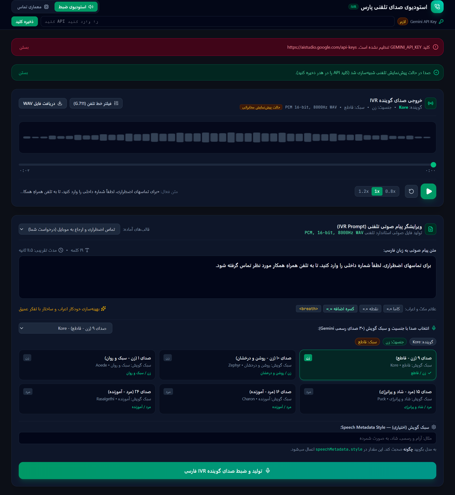
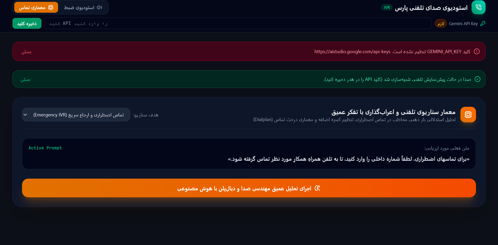

<div dir="rtl">

# 🎙️ استودیوی صدای تلفنی پارس (Persian IVR Studio)

**سامانه هوشمند تبدیل متن به گفتار (TTS) و طراحی سناریوی تلفن گویا (IVR) به زبان فارسی با خروجی استاندارد مخابراتی (`8000Hz WAV`)**

[](https://YOUR-USERNAME.github.io/persian-ivr-studio/)
[](https://aistudio.google.com/)
[](#)
[](#)

> 💡 **نکته قبل از انتشار:** در لینک دکمه `Live Demo` در خط بالا، عبارت `YOUR-USERNAME` را با نام کاربری گیت‌هاب خود جایگزین کنید.

**Persian IVR Studio** یک ابزار تحت وب رایگان، متن‌باز و بدون نیاز به سرور (Client-Side) برای مدیران سیستم‌های تلفنی (VoIP)، مراکز تماس (Call Center) و ادمین‌های **Asterisk، Issabel، FreePBX، Elastix، Cisco CUCM و 3CX** است. این سامانه با استفاده از هوش مصنوعی Google Gemini، متن‌های فارسی را با **اعراب‌گذاری دقیق (کسره اضافه)** و لحن طبیعی و آرام به فایل صوتی استاندارد خطوط تلفن تبدیل می‌کند.

> 🚀 **بدون نیاز به نصب یا سرور:** این برنامه تنها در یک فایل HTML اجرا می‌شود و کلید API شما مستقیماً در مرورگر خودتان (`localStorage`) ذخیره می‌گردد.

---

## 📸 پیش‌نمایش محیط برنامه

| استودیوی ضبط و تولید صدا (Recording Studio) | معمار تماس و اعراب‌گذاری هوشمند (Call Architect) |
| :---: | :---: |
|  |  |

---

## ✨ ویژگی‌ها و امکانات کلیدی

* **🎧 خروجی استاندارد مخابراتی (`PCM 16-bit, 8000Hz Mono WAV`):** تبدیل خودکار نرخ نمونه‌برداری (Resampling) به ۸ کیلوهرتز مونو در مرورگر؛ آماده آپلود مستقیم در **ایزابل (Issabel)، استریسک (Asterisk) و FreePBX** بدون نیاز به تبدیل فرمت.
* **☎️ شبیه‌ساز فیلتر خط تلفن (`PSTN / G.711 Filter`):** پیش‌شنود صدا با فیلتر میان‌گذر (`300Hz - 3.4kHz`) برای تست کیفیت و وضوح واقعی صدا پیش از بارگذاری روی سانترال و خطوط شهری.
* **🗣️ ۳۰ گوینده رسمی خانم و آقا با سبک‌های متنوع:** دسترسی به ۳۰ صدای طبیعی (۱۴ صدای خانم و ۱۶ صدای آقا) همراه با قابلیت تعریف لحن دلخواه (`Speech Metadata Style`) مانند *آرام و رسمی*، *گرم و صمیمی* یا *شمرده و آموزشی*.
* **✍️ ابزارهای کنترل مکث و تلفظ فارسی:** درج سریع **کسره اضافه (`ِ`)** برای جلوگیری از اشتباه‌خوانی در ترکیب‌های وصفی و اضافی (مانند *همراهِ همکارِ*)، مدیریت مکث با کاما و نقطه، و تگ تنفس طبیعی انسانی (`<breath>`).
* **🧠 معمار سناریوی تلفنی و دیال‌پلن (AI Call Architect):** تحلیل بار شناختی تماس‌گیرنده (به‌ویژه در تماس‌های اضطراری)، پیشنهاد نقاط مکث، اعراب‌گذاری خودکار متن، ارائه راهنمای فونتیک و تولید جدول مسیریابی کلیدها (`DTMF Dialplan Matrix`).
* **📋 قالب‌های آماده سازمانی:** شامل سناریوهای از پیش نوشته‌شده برای *تماس اضطراری و انتقال به موبایل*، *خوش‌آمدگویی رسمی شرکت*، *صف انتظار*، *خارج از ساعات اداری* و *نظرسنجی پایان مکالمه*.
* **🔒 حفظ کامل حریم خصوصی:** هیچ داده‌ای به سرور واسط ارسال نمی‌شود؛ ارتباط مرورگر مستقیماً با API رسمی گوگل برقرار است.

---

## 📊 مشخصات فنی خروجی صدا

| ویژگی فنی | مقدار استاندارد در خروجی | سازگاری |
| :--- | :--- | :--- |
| **فرمت فایل** | `WAV (RIFF)` | تمامی سانترال‌ها و نرم‌افزارهای VoIP |
| **کدک صوتی** | `Uncompressed PCM` | استاندارد پایه بدون افت کیفیت |
| **عمق بیت (Bit Depth)** | `16-bit` | Asterisk / Issabel / FreePBX / 3CX |
| **نرخ نمونه‌برداری (Sample Rate)** | `8000 Hz (8 kHz)` | مطابق استاندارد خطوط تلفن شهری (PSTN/G.711) |
| **تعداد کانال** | `Mono (1 Channel)` | بهینه‌شده برای پخش در سیستم‌های تلفنی |

---

## 📖 آموزش گام‌به‌گام استفاده از برنامه

### گام ۱: دریافت و ثبت کلید رایگان Gemini API
1. وارد وب‌سایت [Google AI Studio](https://aistudio.google.com/api-keys) شوید و یک کلید API رایگان بسازید.
2. در نوار بالای برنامه (**هدر**)، کلید خود را در کادر `Gemini API Key` وارد کرده و روی دکمه **«ذخیره کلید»** کلیک کنید. *(وضعیت به «فعال» تغییر می‌کند و کلید در حافظه مرورگر شما ذخیره می‌شود).*

### گام ۲: بهینه‌سازی متن و اعراب‌گذاری (اختیاری اما پیشنهادی)
1. وارد تب **«معماری تماس»** در بالای صفحه شوید.
2. هدف سناریوی خود را انتخاب کنید (مثلاً: *تماس اضطراری و ارجاع سریع* یا *اعراب‌گذاری دقیق کسره اضافه*).
3. روی دکمه **«اجرای تحلیل عمیق مهندسی صدا و دیال‌پلن با هوش مصنوعی»** کلیک کنید.
4. خروجی اعراب‌گذاری‌شده را بررسی کرده و با زدن دکمه **«اعمال به استودیوی ضبط»**، متن اصلاح‌شده را به ویرایشگر منتقل کنید.

### گام ۳: تنظیم گوینده، لحن و تولید فایل صوتی
1. در تب **«استودیوی ضبط»**، متن نهایی را بررسی کنید. در صورت نیاز از دکمه‌های کمکی زیر کادر متن برای افزودن `کسره اضافه « ِ»` یا `<breath>` استفاده کنید.
2. یکی از **۳۰ گوینده** را انتخاب کنید (برای منوهای رسمی و آرام، گویندگان `Kore`، `Zephyr` یا `Aoede` پیشنهاد می‌شوند).
3. در بخش **«سبک گویش (اختیاری)»** می‌توانید دستورالعمل لحن را بنویسید (مثال: `آرام، شمرده، گرم و حرفه‌ای مناسب منشی تلفنی شرکت`).
4. روی دکمه **«تولید و ضبط صدای گوینده IVR فارسی»** کلیک کنید.

### گام ۴: تست مخابراتی و دانلود فایل برای سانترال
1. در بخش **«خروجی صدای گوینده IVR»**، دکمه **«فیلتر خط تلفن (G.711)»** را روشن کنید تا صدای ضبط‌شده را دقیقاً با همان کیفیت و محدوده فرکانسی پشت خط تلفن بشنوید.
2. روی دکمه **«دریافت فایل WAV»** کلیک کنید تا فایل `ivr_audio_8khz.wav` دانلود شود.
3. فایل دانلودشده را مستقیماً در بخش **System Recordings** در ایزابل (Issabel) یا FreePBX آپلود کنید.

---

## 🛠️ اسکریپت کمکی تبدیل فرمت برای Asterisk / Issabel (`scripts/convert-to-pbx.sh`)

در صورتی که در سرور لینوکسی Asterisk یا Issabel نیاز به فرمت‌های فشرده مخابراتی (`ulaw`، `alaw`، `gsm`) دارید، می‌توانید از اسکریپت آماده داخل پوشه `scripts/` استفاده کنید:

```bash
chmod +x scripts/convert-to-pbx.sh
./scripts/convert-to-pbx.sh ivr_audio_8khz.wav
```

---

## ❓ سوالات متداول (FAQ)

**آیا فایل خروجی بدون تبدیل فرمت در ایزابل (Issabel) و استریسک (Asterisk) کار می‌کند؟**
بله؛ فایل خروجی دقیقاً با مشخصات `PCM 16-bit, 8000Hz, Mono WAV` تولید می‌شود که فرمت استاندارد و بومی سیستم‌های مبتنی بر Asterisk است.

**آیا برای استفاده از این برنامه نیاز به نصب Node.js یا پایتون دارم؟**
خیر؛ کل برنامه در یک فایل HTML مستقل ساخته شده است و با باز کردن آن در مرورگر یا از طریق لینک دموی آنلاین اجرا می‌شود.

**چرا در اولین ورود صدای بوق یا شبیه‌ساز پخش می‌شود؟**
تا زمانی که کلید `GEMINI_API_KEY` را در هدر برنامه وارد و ذخیره نکرده باشید، برنامه برای نمایش عملکرد پخش‌کننده در «حالت پیش‌نمایش مخابراتی» قرار دارد. با ثبت کلید API، صدای واقعی هوش مصنوعی تولید می‌شود.

</div>

---

## 🌍 English Summary (For International Developers & GitHub Search)

**Persian IVR Studio** is a zero-backend, single-file web application built with React and Google Gemini API (`gemini-3.8-flash-tts` & `gemini-3.8-flash`) designed specifically for **Persian corporate telephony, VoIP, and IVR systems** (Asterisk, Issabel, FreePBX, Cisco CUCM, 3CX).

### Key Capabilities
- **Telephony-Grade Audio Export:** Automatically downsamples and encodes audio client-side to **PCM 16-bit, 8000Hz Mono WAV**.
- **G.711 / PSTN Bandpass Filter:** Real-time Web Audio API bandpass filter (`300Hz–3.4kHz`) to preview how prompts sound over actual telephone lines.
- **Persian Ezafeh (`ِ`) & Breath Controls:** Built-in tools for Persian diacritics, pause tuning, and `<breath>` tags.
- **AI Call Architect:** Evaluates caller cognitive load, generates phonetic guides, marks Persian Ezafeh, and builds DTMF dialplan routing matrices.

---

## 🤝 مشارکت (Contributing)

پیشنهادها، گزارش باگ‌ها و Pull Requestهای شما برای بهبود کیفیت تلفظ فارسی و افزودن قالب‌های جدید IVR بسیار ارزشمند است. اگر این پروژه برای شما مفید بود، با دادن **ستاره (⭐ Star)** از آن حمایت کنید!
